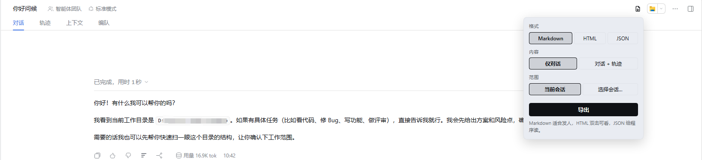
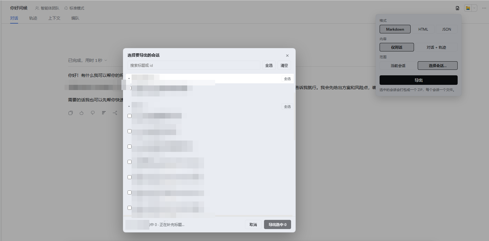

# session-doc-export

把 DSH 会话导出成**人可读**的文档（Markdown / HTML / JSON），可选附带工具轨迹；支持逐条勾选多个会话，打包成 ZIP。

## 项目环境

实测可用的组合：

| 组件 | 版本 |
| --- | --- |
| DSH | `0.2.0-rc.2` |
| Node.js | `v24.17.0` |
| pnpm | `11.9.0` |

Client 半注入 `@deepseek-ai/dsh-client-ui-conversation` 与 `@deepseek-ai/dsh-client-ui-session`，这两个上游包随你的 DSH 版本走，不需要单独安装。

## 安装

这个包是 `private: true` + `@local/` 前缀，**不能发布到 npm，也不能从插件市场安装**，只能用 `link:` 挂到 DSH profile 上。克隆下来不会自动生效。

### 1. 克隆到任意目录

```powershell
git clone https://github.com/eeknight666/dsh-session-doc-export.git <插件目录>
```

下文用 `<插件目录>` 指代克隆出来的路径，不写死盘符。

### 2. 挂到 profile

编辑 `%USERPROFILE%\.dsh\profiles\<profile>\package.json`（Web 端通常是 `web`），改**两处**：

```json
{
  "dependencies": {
    "@local/session-doc-export": "link:<插件目录>"
  },
  "dsh": {
    "profile": {
      "bundles": [
        "@local/session-doc-export"
      ]
    }
  }
}
```

- `dependencies` 里加一行，**值的路径分隔符必须是正斜杠**：`"link:D:/plugins/session-doc-export"`。用反斜杠 pnpm 解析会失败。
- `dsh.profile.bundles` 数组里加包名。这一行决定 DSH 启动时加载它的 host 半。

### 3. 重启 dsh web

```
# Ctrl+C 停掉当前进程，再重新起
dsh web
```

装好后会话页右上角出现导出按钮。

## 项目结构

### 路由

`GET/HEAD /api/session.export-doc`

| 查询参数                       | 作用                                               |
| ------------------------------ | -------------------------------------------------- |
| `?list=1`                      | 列出本机会话骨架（JSON）                           |
| `?titles=1&ids=a,b,c`          | 折叠这些会话的标题（JSON）                         |
| `?sessionId=x`                 | 导出单个会话                                       |
| `?sessionIds=a,b,c`            | 导出选中的多个会话（ZIP）                          |
| `?scope=all`                   | 导出本机全部会话（ZIP）                            |
| `format` / `mode` / `truncate` | md\|html\|json / dialog\|trajectory / 1000..200000 |

### 目录

```
index.js              Host：/api/session.export-doc（列表 / 标题 / 单会话 / 勾选 ZIP / 全部 ZIP）+ /export-doc 命令
client.js             Client：头部按钮 + 选择面板 + 会话勾选浮层（portal）
lib/read-session.js   事件 → 归一化文档（纯函数）
lib/render-markdown.js
lib/render-html.js
lib/md-to-html.js     自带精简 Markdown 转换器
lib/render-json.js
lib/zip.js            自带 ZIP 打包器（store / deflate，UTF-8 文件名）
test/make-fixture.py  把 .dsh 会话解成 fixture.json
test/render-check.mjs 离线渲染自检（六种产物 + 断言）
test/host-check.mjs   mock 上下文跑 apply，验证路由/命令/文件名/批量 ZIP/选择器
test/client-check.mjs 模拟模块加载器，验证 client 注册行为与浮层结构
test/zip-check.mjs    打包 → 交给 Expand-Archive 验证
test/style-probe.mjs  渲染一页排版样例 HTML，供人眼核对
```

## 使用说明

| 入口 | 说明 |
|---|---|
| 会话页右上角**导出按钮** | 文档图标，与「打开方式」「⋯ 更多操作」并排。面板里选 格式 × 内容 × 范围。 |
| 「选择会话…」 | 面板「范围」里的按钮，打开浮层，**逐条勾选**要导出的会话（本机全部工作区，含子 Agent 会话）。 |
| `/export-doc` | 当前会话，Markdown + 仅对话 |
| `/export-doc <格式> [档位] [all]` | 例：`/export-doc html trajectory`、`/export-doc json`、`/export-doc all html` |

格式：`md`（默认）/ `html` / `json`。档位：`dialog`（默认，仅对话）/ `trajectory`（含轨迹）。

- **仅对话**：真人输入 + 助手正文。注入到会话历史的审批通知、运行时快照、技能目录、记忆召回一律剔掉。
- **对话 + 轨迹**：再加模型思考过程、工具名与参数、工具结果、token 用量、模型配置。



### 勾选导出（浮层）

点「选择会话…」弹出浮层，列出本机会话，**按工作区（会话 cwd）分组**，每组一个可折叠的组头：目录名 + 本组条数 + 组内「全选 / 取消全选」。

- **分组按组内最新会话倒序**，最近在用的工作区在最上面。两个不同路径但末段同名的目录（`a/src`、`b/src`）自动退到末两段区分。没有 cwd 的会话单独归到「（未记录工作区）」。
- 每条带标题、时间，以及「子 Agent / 进行中」标记（工作区已在组头上，行内不再重复）。
- **搜索**按标题、id、cwd 过滤；「全选」只选中**当前过滤结果**，便于先筛再全选。搜索命中时**强制展开**所有命中的组，否则命中项被折叠藏着等于没搜到。
- 勾选后点「导出选中」，Host 会把这些会话按勾选顺序渲染，打成一个 ZIP。
- 文件名为 `001_<会话标题>[_含轨迹].md`，序号保证不重名。
- 单条会话读不出来（损坏、已删除）只跳过并计入 `x-export-skipped`，不拖垮整批。
- 上限 200 个会话，防止一次把几百个会话全渲染进内存。



## 常见问题

### 改了代码为什么不生效？

分两种改动，生效方式完全不同：

| 改动位置 | 生效方式 |
| --- | --- |
| **Host 半**（`index.js`、`lib/*.js`） | **必须重启 `dsh web`**。DSH 在启动时把 host 插件 import 进内存，之后改文件不会自动重新加载。 |
| **Client 半**（`client.js`） | **刷新页面**即可（Ctrl+R），界面没变就 Ctrl+Shift+R 绕过缓存。 |

判断依据：如果**界面是新的、接口却报错**（例如 `HTTP 400`、返回内容不认识），几乎一定是 host 半还在跑旧代码 —— 重启 `dsh web`。

## 许可

[MIT](LICENSE)
