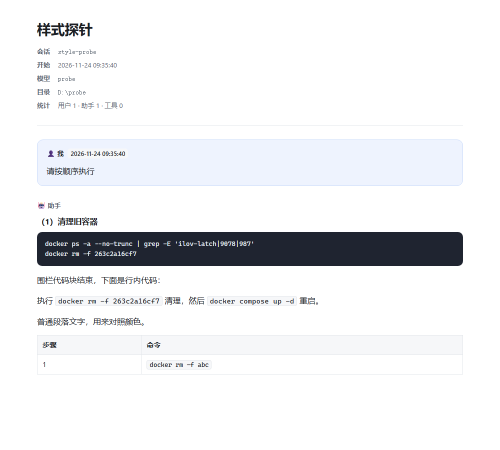

# session-doc-export

把 DSH 会话导出成**人可读**的文档（Markdown / HTML / JSON），可选附带工具轨迹；支持逐条勾选多个会话，打包成 ZIP。

与官方 `dsh-session-log-export` 并存、互不冲突：那个导出原始 `session.v4.jsonl` ZIP（给程序读），这个导出排版好的文档（给人读）。



## 安装

不发布 npm 包，直接从源码挂进 DSH profile。

```powershell
git clone https://github.com/eeknight666/dsh-session-doc-export.git D:\plugins\dsh-session-doc-export
```

改 `~/.dsh/profiles/<profile>/package.json`，**两处都要加**（路径换成你 clone 的位置）：

```jsonc
{
  "dependencies": {
    "@local/session-doc-export": "link:D:/plugins/dsh-session-doc-export"
  },
  "dsh": {
    "profile": {
      "bundles": [
        // ……原有条目保持不动……
        "@local/session-doc-export"
      ]
    }
  }
}
```

再在 `~/.dsh/profiles/<profile>/cordis.patch.yml` 末尾加一条：

```yaml
- id: session-doc-export
  disabled: false
```

然后**重启 `dsh web`**。

> Host 半（路由与命令）只在进程启动时加载，改 `index.js` 必须重启；Client 半（按钮与面板）是浏览器 bundle，改 `client.js` 刷新页面即可。这是最容易踩的坑——面板报 `HTTP 400` 往往就是 Host 还在跑旧代码。
>
> 包名保持 `@local/session-doc-export` 不变。它既是依赖键也是 bundle 条目名，改名会让两处引用一起失效。

## 入口

| 入口 | 说明 |
|---|---|
| 会话页右上角**导出按钮** | 文档图标，与「打开方式」「⋯ 更多操作」并排。面板里选 格式 × 内容 × 范围。 |
| 「选择会话…」 | 面板「范围」里的按钮，打开浮层，**逐条勾选**要导出的会话（本机全部工作区，含子 Agent 会话）。 |
| `/export-doc` | 当前会话，Markdown + 仅对话 |
| `/export-doc <格式> [档位] [all]` | 例：`/export-doc html trajectory`、`/export-doc json`、`/export-doc all html` |

格式：`md`（默认）/ `html` / `json`。档位：`dialog`（默认，仅对话）/ `trajectory`（含轨迹）。
范围：`session`（默认，当前会话）/ 勾选多个 / `all`（全部，仅命令支持）。

## 两个档位

- **仅对话**：真人输入 + 助手正文。注入到会话历史的审批通知、运行时快照、技能目录、记忆召回一律剔掉。
- **对话 + 轨迹**：再加模型思考过程、工具名与参数、工具结果、token 用量、模型配置。

两档都**不导出系统提示词**：它是 Harness 的运行时资产，对读文档的人没有价值，而且动辄几万字符，会把正文压下去。

## 勾选导出（浮层）

点「选择会话…」弹出浮层，列出本机会话，**按工作区（会话 cwd）分组**，每组一个可折叠的组头：目录名 + 本组条数 + 组内「全选 / 取消全选」。

- **分组按组内最新会话倒序**，最近在用的工作区在最上面。两个不同路径但末段同名的目录（`a/src`、`b/src`）自动退到末两段区分。没有 cwd 的会话单独归到「（未记录工作区）」。
- 每条带标题、时间，以及「子 Agent / 进行中」标记（工作区已在组头上，行内不再重复）。
- **搜索**按标题、id、cwd 过滤；「全选」只选中**当前过滤结果**，便于先筛再全选。搜索命中时**强制展开**所有命中的组，否则命中项被折叠藏着等于没搜到。
- 勾选后点「导出选中」，Host 会把这些会话按勾选顺序渲染，打成一个 ZIP。
- 文件名为 `001_<会话标题>[_含轨迹].md`，序号保证不重名。
- 单条会话读不出来（损坏、已删除）只跳过并计入 `x-export-skipped`，不拖垮整批。
- 上限 200 个会话，防止一次把几百个会话全渲染进内存。

### 为什么列表和标题分两步

`SessionHeader` 里**没有标题**——标题是 `session/title` 事件，折叠它要读会话日志。本机实测 81 个会话 / 121 MB，一次性折叠会让浮层卡十几秒。所以：

1. `?list=1` 立刻返回会话骨架（id / 时间 / cwd / 是否子 Agent / 是否 live），浮层秒开；
2. `?titles=1&ids=…` 再异步取标题，边取边填，标题没回来前显示「（未命名会话）」。

单个会话折叠失败只丢它自己的标题，不影响其余。

## 实现要点

1. **只认真人输入**：`user/message` 的 `source.kind === 'user'` 才是你打的字，其余都过滤。
2. **`user/message` 结构特殊**：内容在 `data.content`，其他事件在 `data.message.content`。
3. **surface 折叠**：事件流带 `surfaceOp: 'append' | {op:'replace', startSeq, endSeq}`，压缩会替换旧区间，直接顺序拼接会把已删内容也导出来。
4. **活跃会话先 flush**：`ctx.get('sessions')?.flush(session)`，否则正在跑的会话尾部会缺。
5. **列表优先走 `sessionQuery`**：`listSessions()` 给的是已合并 live 与持久化的逻辑语料；没有该服务时退回 `sessionPersistence.list()`。
6. **浮层 portal 到 body**：会话头部容器可能带 `overflow` / `transform`，原地渲染的浮层会被裁切；拿不到 `react-dom` 时退回原地渲染。
7. **不 import Harness Client 包**：按钮、面板、浮层、样式全部自实现，只用 React + 主题变量。
8. **不引第三方依赖**：Markdown 转换器和 ZIP 打包器都自己写，插件才能离线装进 profile。

### 两个容易踩的排版坑

- `pre code` 的权重必须高过行内 `code`，否则代码块里的内容会被行内样式染成浅底浅字（`.doc pre code` / `.turn pre code`）。
- 表格分隔行要按列拆开校验；拿整行做正则只能认出单列表格，真实会话里的多列表格会全部退化成普通段落。

## 路由

`GET/HEAD /api/session.export-doc`

| 查询参数 | 作用 |
|---|---|
| `?list=1` | 列出本机会话骨架（JSON） |
| `?titles=1&ids=a,b,c` | 折叠这些会话的标题（JSON） |
| `?sessionId=x` | 导出单个会话 |
| `?sessionIds=a,b,c` | 导出选中的多个会话（ZIP） |
| `?scope=all` | 导出本机全部会话（ZIP） |
| `format` / `mode` / `truncate` | md\|html\|json / dialog\|trajectory / 1000..200000 |

## 目录

```
index.js              Host：/api/session.export-doc（列表 / 标题 / 单会话 / 勾选 ZIP / 全部 ZIP）+ /export-doc 命令
client.js             Client：头部按钮 + 选择面板 + 会话勾选浮层（portal）
lib/read-session.js   事件 → 归一化文档（纯函数）
lib/render-markdown.js
lib/render-html.js
lib/md-to-html.js     自带精简 Markdown 转换器
lib/render-json.js
lib/zip.js            自带 ZIP 打包器（store / deflate，UTF-8 文件名）
test/make-fixture.py  把 .dsh 会话解成 fixture.json
test/render-check.mjs 离线渲染自检（六种产物 + 断言）
test/host-check.mjs   mock 上下文跑 apply，验证路由/命令/文件名/批量 ZIP/选择器
test/client-check.mjs 模拟模块加载器，验证 client 注册行为与浮层结构
test/zip-check.mjs    打包 → 交给 Expand-Archive 验证
test/style-probe.mjs  造一页样例给截图核对排版
docs/screenshot.png   README 用的排版截图（由 style-probe 产出）
```

## 自检

全部离线，不需要跑 DSH 运行时。两个断言脚本要读 `test/fixture.json`，**这个文件不入库**——它是真实会话的快照，含本机绝对路径与完整对话内容。先本地生成：

```powershell
python test\make-fixture.py            # 默认取本机最近写入的会话
python test\make-fixture.py <会话目录> fixture.json   # 也可以指定某个会话
```

然后：

```powershell
node   test\render-check.mjs  # 渲染六种产物到 test/out/，带档位断言
node   test\host-check.mjs    # Host 半断言（含选择器与定向 ZIP）
node   test\client-check.mjs  # Client 半结构断言（含浮层）
node   test\zip-check.mjs     # 生成 test/out/bundle.zip
Expand-Archive test\out\bundle.zip -DestinationPath test\out\bundle -Force
```

## 调参

截断长度默认 20000 字符（单个工具结果），落在 Host 的 `DEFAULT_TRUNCATE`，
可用查询参数覆盖：`?truncate=50000`（限制在 1000..200000）。
批量导出的会话数上限是 Host 里的 `BATCH_LIMIT`（200）。

## 许可

[MIT](LICENSE)
